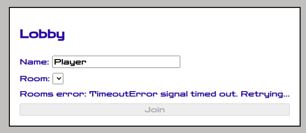
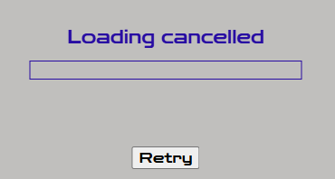
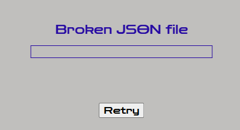

## Lab 01 

### 1. Блокування Event Loop
Для експерименту було навмисно заблоковано основний JavaScript-потік через DevTools, без зміни коду проекту.
```
const startTime = performance.now(); 
while (performance.now() - startTime < 500) { 
}
```

Під час блокування гра на короткий час переставала оновлюватися: `requestAnimationFrame` не міг виконувати наступні callback-и, тому частина кадрів була пропущена. Після завершення циклу виконання гри продовжилося.

До експерименту:

- steps/s: **60**
- frames/s: **144**
- frame time: **7 ms**

Після блокування:

- steps/s: **168**
- frames/s: **119**
- frame time: **1991 ms**

### 2. `setInterval` замість `requestAnimationFrame`
Замість планування наступного кадру через: `requestAnimationFrame(loop)` використовувався таймер:
```
setInterval(() => {
    // ігровий цикл
}, 1000 / 60)
```

Після заміни:

- steps/s: **60**
- frames/s: **63**
- frame time: **17 ms**

`setInterval` намагається викликати `callback` кожні **16.67 мс**, але фактичний інтервал залежить від роботи **Event Loop**. Тому реальний `frame time` може відрізнятися, а кількість `frames` за секунду — коливатися навколо 60. Водночас `fixed timestep` продовжує виконувати симуляцію кроками по 1/60 секунди.

### E3 Змінний `timestep` замість фіксованого
Фіксований крок симуляції `FIXED_DT = 1 / 60` було замінено на реальний час між двома кадрами: `update(frameTime / 1000)`

Після заміни:

- steps/s: **145**
- frames/s: **145**
- frame time: **6.9 ms**

При змінному `timestep` один крок симуляції виконується на кожен кадр. Тому кількість `steps/s` стала приблизно дорівнювати `frames/s` і становила **145**. Реальний час кадру становив **6.9 мс**. На відміну від fixed `timestep`, частота виконання фізики тепер залежить від частоти кадрів браузера.

## Lab 02

### 1. Баг із this та виправлення
Метод fire() використовує властивості танка через this. Якщо передати його як звичайну функцію, контекст виклику може загубитися:
```
createInput(tank.fire);
```
Значення this залежить від способу виклику. При tank.fire() воно вказує на tank, а при звичайному виклику функції в strict mode дорівнює undefined.

Використаний фікс у main.js:
```
const input = createInput((action) => {
    if (action === "fire") tank.fire();
});
```
Метод викликається через об’єкт, тому this вказує на актуальний екземпляр танка. Це також дозволяє коректно працювати після респауну, коли змінна tank посилається на новий об’єкт.
Альтернатива — `tank.fire.bind(tank)`, але вона прив’язує метод до конкретного екземпляра. Стрілкова функція не має власного this, проте тут викликає метод безпосередньо через tank.

### 2. Дизайн-запис: композиція замість глибокої ієрархії
Можлива ієрархія на основі спадкування:
```
Entity
├── Tank
├── Bullet
│   └── HomingBullet
├── Missile
│   └── HomingMissile
├── Pickup
│   ├── HealPickup
│   └── HomingAmmoPickup
└── Explosion
```
Така структура дублює поведінку самонаведення для куль і ракет. Додавання незалежних можливостей, наприклад вибуху при смерті, призводило б до появи додаткових класів-комбінацій. JavaScript не підтримує множинне спадкування класів.

**Обраний підхід**: Tank, Bullet та Explosion успадковують базовий Entity, а додаткова поведінка реалізується компонентами.
- homing — компонент самонаведення, який можна додавати різним сутностям із відповідними параметрами. Це дозволяє повторно використовувати поведінку без створення окремих підкласів.

- pickup — компонент бонусу з ефектом і кольором. Бонус є звичайною сутністю Entity: він стоїть на місці, бере участь у колізіях і застосовує ефект при підборі, але не є кораблем.

- explosive — компонент вибуху при смерті, який можна додавати потрібним сутностям незалежно від їхнього класу.

Компоненти зберігаються в Entity та викликаються під час оновлення або смерті сутності. Колізії обробляються окремою системою за типами kind.

## Lab 03

### 1. Головоломки порядку мікрозадач і задач

**Головоломка 1**
```js
console.log("A");
setTimeout(() => console.log("B"), 0);
Promise.resolve().then(() => console.log("C"));
console.log("D");
```
Вивід: `A D C B`
Спочатку виконується синхронний код (A, D), потім мікрозадача (C), і лише після неї наступна макрозадача (B).

**Головоломка 2 (await)**
```js
async function f() {
	console.log("1");
	await null;
	console.log("2");
}
f();
console.log("3");
```
Вивід: `1 3 2`
Код до першого `await` виконується синхронно, а решта функції стає мікрозадачею і виконується після синхронного коду.

**Головоломка 3 (setTimeout всередині .then)**
```js
setTimeout(() => console.log("timeout 1"), 0);
Promise.resolve()
	.then(() => {
		console.log("then 1");
		setTimeout(() => console.log("timeout 2"), 0);
	})
	.then(() => console.log("then 2"));
```
Вивід: `then 1`, `then 2`, `timeout 1`, `timeout 2`
Обидва `then` є мікрозадачами й виконуються раніше за будь-який таймер, а таймери спрацьовують у порядку реєстрації.

**Головоломка 4 (requestAnimationFrame)**
```js
requestAnimationFrame(() => {
	console.log("raf 1");
	Promise.resolve().then(() => console.log("micro in raf"));
});
requestAnimationFrame(() => console.log("raf 2"));
```
Вивід: `raf 1`, `micro in raf`, `raf 2`
Мікрозадачі виконуються після завершення кожного колбека, тому `micro in raf` вклинюється між двома rAF-колбеками.

**Головоломка 5 (await і ланцюжок then)**
```js
async function a() {
	console.log("a1");
	await b();
	console.log("a2");
}
async function b() {
	console.log("b");
}
a();
Promise.resolve().then(() => console.log("p1")).then(() => console.log("p2"));
console.log("end");
```
Вивід: `a1 b end a2 p1 p2`
`b()` виконується синхронно, а продовження `a2` потрапляє в чергу мікрозадач раніше за `p1`, бо `a()` викликано першим.

### 2. Галерея збоїв

Гра в жодному з випадків не падає: або показується зрозуміле повідомлення з кнопкою **Retry**, або (для лобі) запит автоматично повторюється.

| Збій | Як відтворити | Що бачить гравець | Скріншот |
|---|---|---|---|
| Таймаут мережі | DevTools → Network → Throttling → Add custom profile з дуже малою швидкістю (1 kb/s). Для лобі: `DELAY=10000 npm run dev` (PowerShell: `$env:DELAY=10000; npm run dev`) | «Network timeout» + Retry. У лобі: «Rooms error... Retrying...» |  |
| Abort посеред завантаження | Fast 3G, оновити сторінку й натиснути Esc під час завантаження | «Loading cancelled» + Retry |  |
| Битий JSON | Видалити останню `}` у `public/manifest.json` | «Broken JSON file» + Retry. Повторів немає, бо файл не зміниться |  |

Після виправлення причини кнопка Retry знову запускає завантаження, і гра стартує нормально.